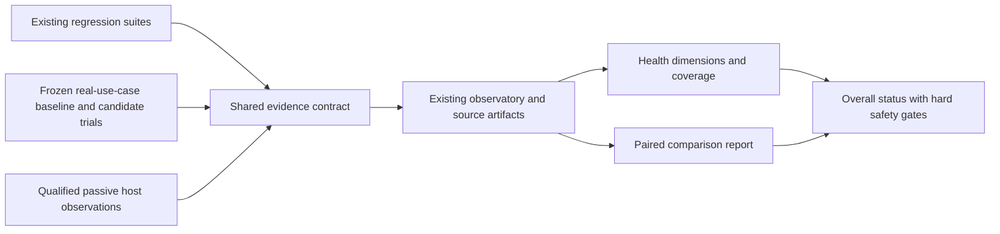

# Shared harness health and comparative evaluation plan

Status: independently reviewed and ready for foundation implementation. Operational deployment remains unimplemented and unqualified. Date: 2026-10-31.

## Outcome

Provide one shared view of harness health, grounded in repeatable real-use-case evaluations and operational observations. Compare a frozen baseline with a proposed skill, tool, process or model change before transition. Support Claude Code and Codex from the shared root, Klever/project-management, registered repositories and unrelated working directories, with explicit coverage for each surface.

Reuse the existing eval registry and observatory. Add host adapters, outcome evaluations and comparison records. Do not create a second skill catalog, knowledge library, generic runner registry or dashboard database.

This document proposes implementation. It does not install hooks, alter settings, enable schedules, run paid agent evaluations, promote Kev or change source knowledge.

## What the user should see

An overall status: **insufficient evidence**, **blocked**, **baseline qualified**, **regression**, **improved**, or **inconclusive**. Show the declared scope, reason and links to evidence. A successful script run alone cannot produce an improved status.

Under that status, show six dimensions:

| Dimension | Meaningful signals | Essential qualification |
|---|---|---|
| Safety and policy | Effective guard behavior, unauthorized effects, false blocks | A critical failure vetoes a green overall status. Fixture conformance does not imply runtime enforcement. |
| Verified task quality | Accepted outcomes, required evidence, important omissions, defects and rework | Independent checks or explicit acceptance. Assistant completion statements remain claims. |
| Efficiency | Time, tokens, retries and resource use per verified outcome | Do not reward fast failure, partial work or skipped difficult tasks. |
| Human effort | Explicit interventions, measured review/rework time | Never infer human minutes from machine elapsed time or approval count. Unknown stays unknown. |
| Coverage and freshness | Qualified hosts, projects, task families, captured episodes, current tested revisions | Missing events and unsupported surfaces cannot count as zero failures. |
| Maintainability | Broken wiring, stale fixtures, adapter/schema drift and maintenance effort | A new collector's own overhead and failures are measured. |

A later numeric quality index can use a fixed, versioned task basket and frozen family weights. An overall performance index is secondary, must expose its formula and coverage, and cannot average away critical failures. The MVP should not invent an overall number before its denominators and task outcomes are trustworthy.

Show fixed-basket comparisons separately from the observed workload mix. A larger proportion of easy tasks must not manufacture a harness improvement.

### Version-zero status policy

Implement this policy with the first outcome tracer, not only after the whole program is complete:

- Scope is explicit: host/surface, project/context, task family, baseline/candidate fingerprints and case-set revision. A narrow qualified result is not machine-wide certification.
- Missing mandatory case evidence, incomplete required labels, an unqualified adapter, unknown tested fingerprint or expired qualification produces **insufficient evidence**. Optional human-effort data can remain unknown when no human-effort claim is made.
- An observed critical intended-policy violation or failed measurement-validity control produces **blocked**. Known characterization tests do not turn a policy violation green.
- **Baseline qualified** means the measurement and required checks are valid for that declared scope, current fingerprint and registered freshness window. It does not mean the system is risk-free.
- **Regression** requires a prespecified worsening condition against the qualified baseline. **Improved** requires mandatory safety/quality constraints plus the registered primary improvement condition and its uncertainty criterion. Otherwise a valid comparison is **inconclusive**.
- Each task-family protocol declares its freshness window and requalification triggers before runs. Missing freshness policy prevents a current qualified status. Display stale/unsupported strata and unknown denominators rather than dropping them from the view.

The first useful outcome milestone is one calibrated knowledge/continuity baseline-versus-candidate report across both CLIs. It must include actual artifact outcomes, uncertainty, resource measurements, scoped status and missing coverage. Desktop qualification, passive capture and scheduling are independently useful later milestones, not prerequisites for that first report. Do not require a full host × surface × cwd × family cross-product before showing useful scoped evidence.

## Three complementary measurement paths

Regression evaluations protect known rules. Outcome evaluations test whether real work succeeds. Passive telemetry finds operational patterns and supplies candidate cases. Passive correlations do not establish that a particular skill caused an improvement.

## Architecture and data ownership

Canonical code remains under `~/.claude-shared-config/harness/`. Thin Claude and Codex adapters call the same capture and publication code. Existing skills remain shared through their current canonical sources and links.

Extend the strict observatory schema through additive, tested migrations. Keep current records and producer outputs authoritative. Required new domains:

- **Episode:** a bounded user task, task family, host/surface, context and lifecycle.
- **Measurement:** numerical value, unit, measured/estimated/reported semantics, source and missingness.
- **Verified outcome:** criterion-level evidence, grader identity/revision, acceptance and uncertainty.
- **Exposure/intervention:** which skill, tool, process or version was requested, loaded, actually executed or experimentally assigned.
- **Comparison:** baseline/candidate fingerprints, case-set and grader revisions, assignments, paired outcomes and analysis policy.

A common envelope preserves event and source IDs, adapter/schema versions, host/engine/model/config fingerprints, parent/subagent relationships, project/org/repository identity, declared context, canonical cwd, source reference, evidence class and coverage status. Unsupported fields are nullable. Collector claims cannot become authoritative eval passes.

Preserve native token counters and their scope before normalization. Deduplicate cumulative/final and parent/subagent records. Distinguish reported cost, dated price estimates and actual billing. Subscription usage does not establish an incremental dollar bill. Do not sum parallel tool durations into elapsed time.

## Context and privacy

Resolve project context per event using explicit session/project declarations, canonical repository identity and the existing workspace map. Preserve declared and cwd-derived contexts separately. A conflict becomes unresolved scope. Unrelated cwd becomes unknown, never implicit Klever.

Capture admission is deny-by-default. Registered canonical roots/repository identities admit project activity. Shared-global activity requires an explicit shared-harness context and a registered shared capability; it is not a fallback for arbitrary directories. Unknown, conflicting and denied contexts produce only anonymous capture-gap counts, without cwd paths, prompts, session identifiers or project activity. Task execution itself remains unaffected.

Maintain an explicit project/scope registry. Shared inventory may be machine-wide; activity and reports remain scoped. Initial activity scope is shared-global and Klever, including project-management. The design supports further registered contexts without reading their private data in this investigation.

For passive capture, extract only allowlisted IDs, timestamps, capability names, result categories and supported usage counters. Discard prompts, arguments, outputs, environments and transcript bodies before persistence. Sensitive corpus or task snapshots used for evaluations require a separate private evidence policy and sanitized replay fixtures. Do not automatically mine arbitrary machine-wide transcripts or send them to a model.

Admission precedes opening historical sources. The current broad catalog refresh/collector opens Codex histories before filtering individual events, so it must not be reused unchanged for this scope promise. Use admitted explicit sources or incoming events. Historical mixed-scope files require a separate approved ingestion policy; otherwise skip them. Validate symlinks, copied directory names, cwd changes and conflicting declarations against canonical identities.

Apply the same allowlist to database rows, spool files, error text, debug logs and generated reports. Use owner-only permissions for private evidence, bounded configurable retention and separate sanitized public exports. Do not automatically publish private artifact paths or raw failure output. The narrow eval producer tracer does not need the broad activity collector.

Observational collection must preserve the original tool/task outcome. It adds no prompt context, approval decisions or continuation instructions. Bound payload size, processing time and spool size. Record dropped events and capture failures. Failures use local spooling and bounded retry, not hidden permission changes or model-driven repairs.

## Representative task families

Start with a small developer set, then independently sample real episodes for a locked evaluation set:

1. Knowledge retrieval: find the applicable page, preserve critical rules and recognize absent evidence.
2. Session continuity: recover the correct session and preserve decisions/handoffs without raw ledger writes.
3. Ticket/spec work: honor local AC overrides, use correct ticket placement and preserve open questions.
4. Investigation: test premises, distinguish unavailable data from absent entities and avoid unsupported causes.
5. Implementation/review: produce independently verified behavior and catch weakened assertions or wrong-environment claims.
6. Documentation/shipping: preserve architecture ownership, evidence and authorization boundaries.

Each case defines the required outcome, legitimate refusal behavior, allowed effects, evidence source and grader. Use neutral prompts and scripted worlds. Mock external writes and expensive infrastructure. Discovery cases do not name the desired skill. Paired arms preserve explicit user-selected models and workflows.

## Baseline and comparison protocol

Freeze the task/corpus snapshot, candidate and baseline components, host/surface, engine/model configuration, tool set, relevant instructions, source bytes including dirty/untracked files, environment, grader and case revisions. Git HEAD alone is insufficient.

Use fresh sessions and isolated writable fixtures. Pair trials by task and host. Randomize arm order and separate carryover/context-cache effects. Repeat runs to estimate variability. Keep interrupted and excluded runs in the accounting. Analyze paired task/session groups, not individual tool calls as independent samples.

### Component drift and reassessment

Changes to a case/world/corpus, grader, model/engine, relevant instructions, tool schema, hook matcher, preprocessing, adapter semantics or policy invalidate affected current qualifications. Dependency mapping limits the affected scope; it must not erase stale cases from the coverage denominator. Preserve the old result as historical evidence and run targeted requalification.

Proven non-behavioral changes, such as an unrelated document correction, can be annotated without invalidating an unaffected comparison. Unknown impact defaults to requalification. A new summary formula or family weighting is a new analysis-policy version; recomputation does not rewrite raw outcomes or become a preregistered success retroactively. Fixture replay can remain valid while live external-service qualification becomes stale. Label those claims separately.

Register outcome criteria, safety constraints, acceptable quality/latency tradeoffs, sample size rationale, repetitions, cost/token/wall caps and stopping rules before inspecting locked results. The pilot's 100 independent queries are a minimum for its proposed quality study, not a universal guarantee of safety or statistical power. Report uncertainty and important failures, not only a mean.

Calibrate graders on known-bad, gamed and legitimate successful cases. Test empty output, tool success without task success, weakened assertions and missing evidence. Instruction-removal ablations test whether the harness component causes the observed behavior. Kev cannot be its own sole quality judge.

Passive observations can identify a change worth testing. Controlled paired trials support attribution. A bundle of model, tool and process changes gets a bundle-level claim unless additional ablations support narrower attribution.

## Implementation phases

### Phase 0: preserve and qualify the measurement foundation

Deliverable: a reproducible source/eval inventory and isolated deterministic baseline.

Acceptance criteria:

1. Preserve the existing dirty/untracked observatory implementation, establish the intended versioned source, pin an interpreter/dependency environment and inventory all suites, exclusions, fixtures, host applicability and current fingerprints.
2. Add an isolated evaluation mode with a frozen explicit source/manifest, fixture HOME, minimal child environment, temporary database/view/spool/report paths and no production credentials. Enforce write containment and a deny-by-default network/connector policy using a qualified disposable execution boundary. A command-line output directory alone is not a sandbox. Kill and reap the subprocess tree on timeout. Admit only audited fixture-safe suites until escape controls pass. Reconcile omitted suites, intended-policy versus characterization results, wrapper exit propagation and current failure-delivery routing without repinning known failures.
3. Run a fresh deterministic baseline and store per-case pass/fail/error/not-run plus tested revisions, timing and effective dispatch evidence. Assert operational manifests, inboxes, databases, source knowledge and user projects are unchanged by isolated tests.

Validation: missing dependencies, timeout, empty/malformed output, wrong matcher/path, false block, failed publication and known-red controls. Deliberately attempt an out-of-fixture write, a forbidden connector/network call and a surviving child process; the execution boundary must prevent them. Integrity checks remain an additional check, not containment. If no suitable boundary is available, mark that suite blocked and never fall back to unrestricted execution. No model calls in this phase. Existing monthly production execution remains unchanged until its replacement path is qualified.

### Phase 1: extend the existing observatory contract

Deliverable: typed episodes, measurements, outcomes and comparisons with fixture adapters.

Acceptance criteria:

1. Add compatible migrations and supported producer writers for the new domains, source fingerprints, units, missingness and explicit ownership. Preserve original producer results and exit codes.
2. Normalize recorded golden fixtures from each host without reading live private histories. Prove deduplication across resumed sessions, subagents and cumulative usage. Unsupported fields stay unknown.
3. Add a health/coverage view to the existing renderer, using the version-zero scoped status policy. A report must distinguish passing assertions, policy failures, capture errors, stale evidence and unjudged outcomes. No data or all-skipped runs cannot produce green status.

Validation: backup/rollback, immutable replay, concurrent writes, schema/adapter drift, corrupted receipts, false-success controls and redaction. Use temporary databases.

### Phase 2: qualify host adapters and any-cwd behavior

Deliverable: a measured compatibility matrix for both products and both local surfaces.

Acceptance criteria:

1. Validate bounded headless CLI trials separately for Codex and Claude, preserving native events and actual artifact effects. Freeze budget and permitted operations before runs.
2. Review and trust the exact hook definitions where required, then test fresh desktop sessions separately. Cover successful completion, tool failure, interrupt, resume, compaction, subagents and unsupported tool paths. Installed CLI support does not certify desktop behavior.
3. Verify routing in the shared root, a Klever code repository, project-management and an unrelated directory. Project-management remains on main with no branches/worktrees. All evaluation mutations use disposable fixtures outside that repository. Ledger mutations continue through the existing helper.

Validation: real event delivery rather than configuration substring matches, app/CLI version divergence, quoted examples, delayed unified-exec completion, scope conflicts and capture gaps. Measure collector overhead against an uninstrumented control before activation. Unsupported surfaces remain explicitly unqualified.

### Phase 3: evaluate real outcomes and the Kev intervention

Deliverable: a representative outcome suite and a valid baseline/candidate comparison.

Acceptance criteria:

1. Sample authorized real use cases, sanitize them into repeatable worlds and split development/calibration/locked data by originating session and topic. Preserve selection provenance and label disagreements. Pin a fixed basket and disclose observed workload mix.
2. Use independent outcome labels and calibrated graders. Measure verified task success, essential omissions, false suggestions, review/rework and whole-task efficiency. Do not infer human time saved from machine execution time.
3. Reuse Kev receipts and snapshots, but preserve the actual incumbent as the deployment-effect baseline. Define the distinct comparison arms and independent relevance references below. Complete the registered independent-query requirement before a recall-improvement claim.

Validation: known-good and degraded arms, neutral prompts, genuine negative cases, instruction ablation and blinded result review. Pre-register sample-size and tradeoff decisions before locked evaluation. Do not tune against an inspected holdout.

Comparison arms and claims:

- **A: frozen current operational retrieval.** Preserve the relevant host/context behavior, source scopes and initial state. The pilot's global-only fresh-state alias port is a diagnostic subset, not automatically a full operational baseline.
- **B: full-text lexical retrieval.** This is a stronger control and a separate candidate, not a silent replacement of A. Freeze text windows, preprocessing, candidate limits, abstention, truncation, timeout and fallback behavior.
- **C: Kev reranking of B's same candidate pool.** Compare B's ordering with C's ordering under matched available information and input budgets to isolate reranking. Evaluate A versus the complete proposed pipeline separately for deployment effect.

Keep native end-to-end latency/resource measurements alongside matched-budget analyses. Choose variants before inspecting locked labels. A result against A cannot be generalized to B or to other hosts and workloads.

Complete pooled returned-result labels for precision/ranking judgments, and separately establish independently judged required/essential documents per query through corpus review or a declared broad discovery process. Adjudicate disagreements without arm identities. Include genuinely absent-answer cases and essential-document omissions. Returned pools alone cannot establish what both arms missed. If independent corpus-level references are infeasible, label the metric **recall against the judged pool** and withhold a general recall-improvement claim. Increasing query count does not repair an unknown denominator.

### Phase 4: add bounded operational monitoring

Deliverable: passive local observations, periodic summaries and change-linked comparison requests.

Acceptance criteria:

1. Activate only qualified observational adapters for admitted registered scopes. Prove deny-by-default unknown-context admission before history access, metadata-only handling through errors/spools/reports, bounded retention/retry, source outcome preservation and measured overhead. Task acceptance and human-effort labels stay explicit or unknown.
2. Inventory installed and hosted schedules before adding one. Reuse an appropriate confirmed schedule, or install one deterministic collector/report job with pinned paths/interpreter, locking, timezone, missed-run semantics and retention. Keep behavioral trials separately capped and on-demand initially.
3. Record component/config changes as exposures. Show before/after associations with their limitations, nominate cases for controlled comparisons and record capture/freshness drift. No automatic rollout, retirement or knowledge mutation follows from a trend.

Validation: offline mode, full spool, stale sources, parser failure, dropped events, unavailable host and repeated scheduling. Notifications carry sanitized summaries and link original evidence through current routing. Avoid one inbox item per ordinary eval result.

### Phase 5: qualify a summary index and transition policy

Deliverable: a useful overall view with published limits and evidence-backed transition decisions.

Acceptance criteria:

1. Freeze task-family weights, metric definitions, minimum coverage/freshness and confidence requirements. Missing mandatory evidence produces unrated/insufficient status. Critical safety regressions veto a green result regardless of speed or cost.
2. Demonstrate that adding easy tasks, skipping hard cases, duplicating subagent events, changing model versions or losing instrumentation cannot manufacture improvement. Display dimensions and evidence beside any aggregate.
3. Review each baseline/candidate report independently. Require qualified host/context coverage, acceptable task quality and bounded resource/overhead tradeoffs before a staged transition with an explicit disable path.

The index is a versioned measurement policy, not an objective universal measure of intelligence. Its dashboard can be common across the machine while its denominators remain scoped and comparable.

## First implementation slice

Build Phase 0 first, then a narrow Phase 1 tracer: one existing deterministic suite produces a fingerprinted result into the existing observatory from an isolated run. Prove it with both a real pass and a calibrated failure. This establishes that the measurement pipeline itself can be trusted before adding model runs or passive hooks.

The next tracer follows one real knowledge/continuity task family through both CLI adapters. Desktop hooks and automatic scheduling follow qualified evidence, not skill discovery or configuration presence.

## Dependencies and human decisions

- The intended existing observatory source must be preserved and versioned before changes.
- New non-managed Codex hook definitions require native trust review. This plan does not bypass that mechanism.
- Workload importance weights, human-effort labeling burden and quality/latency tradeoffs require Gabriel's choices before their relevant locked study or numeric index. They do not block foundation work.
- Scheduling installation and passive capture are later activation steps. This investigation did not change them.

## Evidence and review

See [INVESTIGATION.md](INVESTIGATION.md) for actual assets, limitations, installed versions and primary sources. See [REVIEW.md](REVIEW.md) for the independent adversarial review and resulting revisions. Interactive `/crit:crit` review is recommended for the written plan before implementation.
